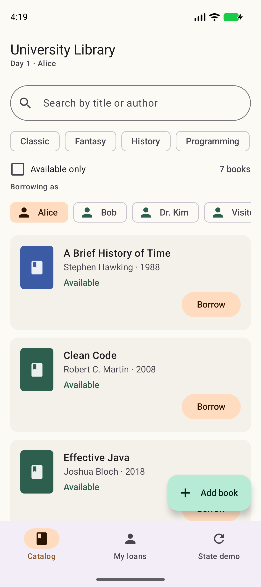
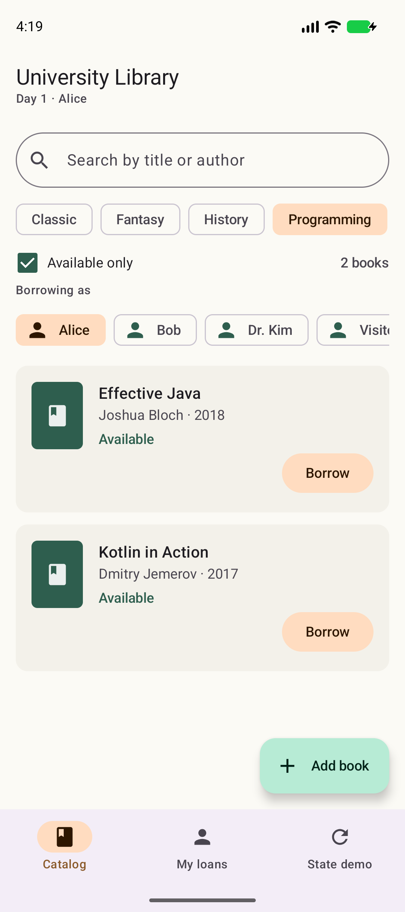
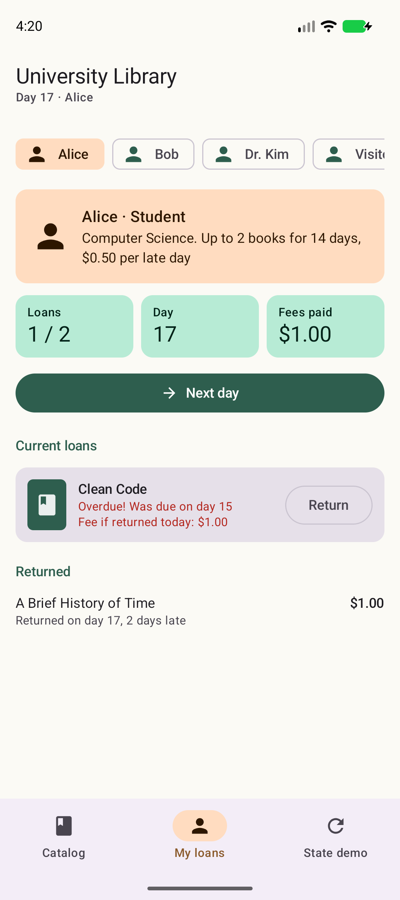
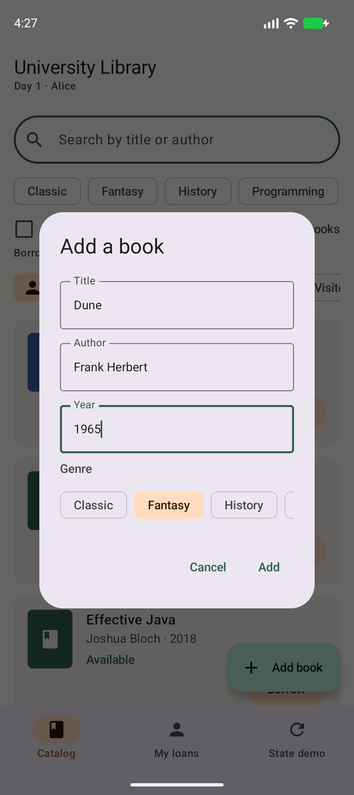
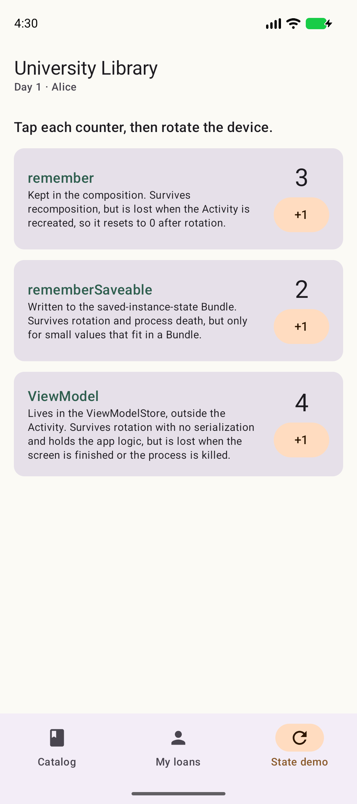
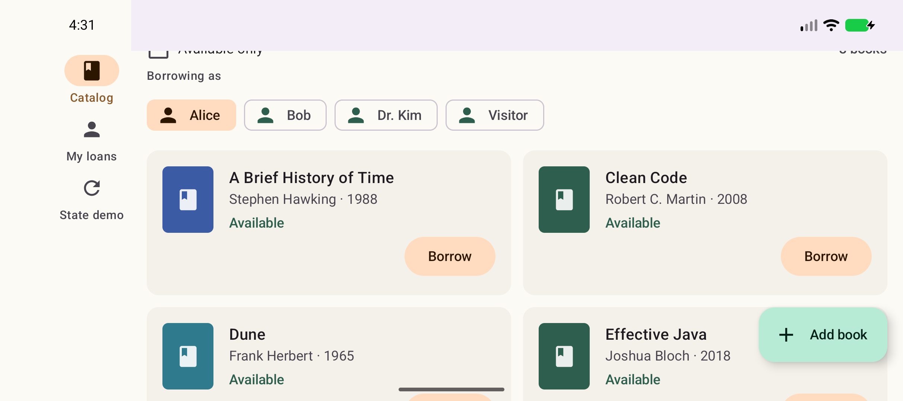

# University Library (Android)

An Android app for a small university library, built with Kotlin, Jetpack Compose, Material 3 and a ViewModel. It reuses the `Library`, `Book`, `Member`, `Loan` and `PublisherFeed` classes from the HW1 console app (`../src/main/kotlin/library/`).

The four members (two students, a professor and a guest) keep their HW1 rules: each type has its own loan limit, loan period and late-fee policy.

## Features

- Catalog: search by title or author, filter by genre chips and an "Available only" checkbox, and see each book's status (available, due, or overdue and who has it).
- Borrowing and returns: borrow a book as the selected member and return it from the catalog or from My loans. The app refuses a book that's already on loan or a member who has hit their limit, and explains why in a snackbar.
- My loans: the member's details, loan count, current day and fees paid. Current loans show their due day and the fee if returned today, and returned books are listed with what was paid. "Next day" moves the calendar forward.
- Add a book: a dialog with title, author, year and genre. The year is validated, and Add stays disabled until the form is valid.
- New arrivals: on start, two simulated publisher feeds load in parallel with coroutines, and their books appear in the catalog.
- State demo: three counters kept with `remember`, `rememberSaveable` and the ViewModel. Rotating the device shows which ones survive Activity recreation.
- Adaptive, edge-to-edge layout: a bottom navigation bar on phones in portrait, and a navigation rail with a multi-column grid on wider windows such as a landscape phone or a tablet. The app bar hides as you scroll, and content draws behind the system bars.

## Screenshots

| Catalog | Search and filters | My loans |
|---|---|---|
|  |  |  |

| Add a book | State demo, before rotation | State demo, after rotation |
|---|---|---|
|  |  |  |

Landscape: navigation rail and a two-column grid. Dune is the book added in the dialog above.



## How to run

You need Android Studio (built and tested with 2026.1.4) and an emulator or a phone running Android 8.0 (API 26) or higher. The app compiles against API 37.

1. Open the `android-app` folder in Android Studio, not the repository root. The root holds the HW1 console app.
2. Wait for the Gradle sync. Gradle downloads the JDK it needs on its own.
3. Pick an emulator or a connected phone and press **Run**.

From the command line, with a device connected:

```bash
cd android-app
./gradlew installDebug
```

On Windows use `gradlew.bat installDebug`. Then open **Library** on the device.

## Where the requirements are

All code is in `app/src/main/java/library/mobile/`.

| Requirement | Where |
|---|---|
| Kotlin + Jetpack Compose | Every screen is a `@Composable`. `MainActivity.kt` calls `setContent { LibraryTheme { LibraryApp() } }` |
| Material 3 and consistent styling | `ui/theme/Theme.kt` defines light and dark colour schemes. Screens use M3 `Scaffold`, `TopAppBar`, `NavigationSuiteScaffold`, `Card`, `FilterChip`, `ExtendedFloatingActionButton`, `AlertDialog` and `Snackbar` |
| At least 3 reusable composables | `ui/components/`: `BookCard`, `BookCover`, `SearchField`, `GenreChips`, `MemberSelector`, `LabeledCheckbox`, `StatCard`, `EmptyState`, `SectionHeader`, `AddBookDialog` |
| `Row`, `Column`, `Box` | `BookCard.kt` (a `Row` of cover and text inside a `Column`, with the cover in a `Box`), `LoansScreen.kt` (`Row` of stat cards), `StateDemoScreen.kt` (`Column` of counter cards) |
| `LazyColumn`/grid, `Card`, `Text`, `Image` | Catalog and loans use `LazyVerticalGrid` with adaptive columns, chip rows use `LazyRow`, books are `Card`s, and `BookCover` and `EmptyState` use `Image` |
| At least 2 interactions | Search, genre filter, availability filter, choosing a member, borrow, return, next day, add book |
| Input components | `OutlinedTextField` (search, add-book form), `Checkbox` (`LabeledCheckbox`), `Button`, `FilledTonalButton`, `OutlinedButton`, `FilterChip` |
| UI updates on user actions | `LibraryViewModel` exposes a `StateFlow<LibraryUiState>`, and `LibraryApp` collects it with `collectAsStateWithLifecycle()`, so every action recomposes the affected screen |
| `remember` / `rememberSaveable` | `remember`: card expansion in `BookCard`, the snackbar host state. `rememberSaveable`: the selected tab and dialog visibility in `LibraryApp`, the add-book form fields in `AddBookDialog` |
| ViewModel | `ui/LibraryViewModel.kt` owns the `Library`, the filter, the selected member and the current day. It loads new arrivals in `viewModelScope` |
| UI separate from state | Screens receive `LibraryUiState` plus an actions object (`CatalogActions`, `LoansActions`) and never see the ViewModel. Filtering lives in `CatalogFilter.matches` in `LibraryUiState.kt` |
| State across Activity recreation | The State demo tab: rotate and only the `remember` counter resets. Loans, filters and the day survive because they live in the ViewModel |

## remember vs rememberSaveable vs ViewModel

| | Survives recomposition | Survives rotation | Survives process death | Use it for |
|---|---|---|---|---|
| `remember` | Yes | No | No | Throwaway UI state, like whether a card is expanded |
| `rememberSaveable` | Yes | Yes | Yes | Small UI state the user would miss, like the selected tab or half-typed form text. It must fit in a `Bundle` |
| `ViewModel` | Yes | Yes | No | Screen state and app logic: the library, loans, filters. It lives outside the Activity, so there's no serialization and no size limit |
